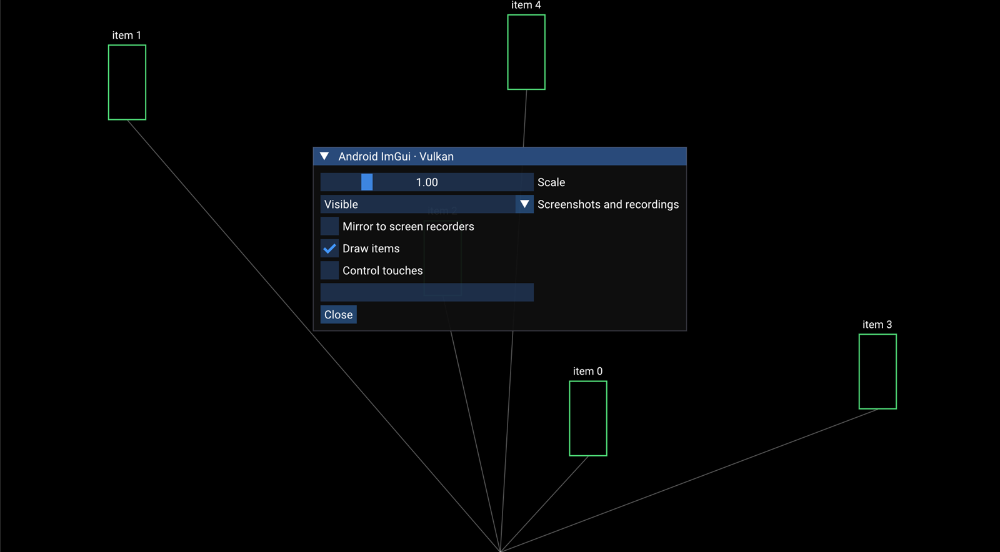

# android-imgui

external Dear ImGui overlay for android, drawn straight from a root binary. no apk, no zygisk, no
injecting into anything: it runs as its own process. you push one ELF, run it with `su`, and get
a [Dear ImGui](https://github.com/ocornut/imgui) menu on top of the whole screen.

c++23 + Dear ImGui 1.92, three render backends (OpenGL ES, Vulkan, CPU) and one binary for
android 5 → 17. want the same thing in rust + egui? thats
[android-egui](https://github.com/MisterJerkins/android-egui).



```cpp
#include "Graphics/Graphics.h"
#include "Input/Touch/Touch.h"
#include "Window/ANativeWindowCreator.h"

int main() {
    NativeWindow window = ANativeWindowCreator::Create("my-overlay");            // the layer over the screen
    std::unique_ptr<Graphics> graphics = GraphicsManager::Create(window);        // OpenGL ES, Vulkan or the CPU
    if (!graphics || !touch.Init(*graphics)) {                                   // then the touches
        return 1;
    }
    char name[64] = "";
    while (graphics->NewFrame()) {
        ImGui::Begin("Menu");
        ImGui::InputText("name", name, sizeof name);
        ImGui::End();
        graphics->EndFrame();
    }
    return 0;
}
```

thats the whole thing. the full demo (menu, scale slider, capture modes, touch control, moving
"items") is [src/Main.cpp](src/Main.cpp), ~90 lines, all of it in `main`.

## Quick start

build it (see [Building](#building)), then

```bash
adb push out/arm64-v8a/android-imgui /data/local/tmp/android-imgui
adb shell "chmod 755 /data/local/tmp/android-imgui; su -c /data/local/tmp/android-imgui"
```

first arg picks the backend: `auto` (default), `gl`, `vk`, `cpu`.

| env | what it does |
|---|---|
| `ANDROID_IMGUI_LOG=debug` | log level (`trace` / `debug` / `info` / `warn` / `error` / `off`), goes to stderr and logcat |
| `ANDROID_IMGUI_TOUCH=system` | take touches from the system input monitor instead of evdev |

## What it can do

| | |
|---|---|
| layer | android 5-17. every `libgui.so` call is picked by which symbol actually exists, not by version number, so a weird rom gives you an error instead of a segfault. rotation is followed live |
| backends | OpenGL ES 2+, Vulkan 1.0+, and a CPU rasterizer. `GraphicsApi::Auto` tries them in that order |
| ImGui | 1.92, unmodified, with its dynamic fonts: text stays sharp at any scale and any size, pictures and fonts go through the same texture path on all three backends |
| idle | ImGui normally redraws every frame. here a frame is built only after input or when you ask for one, and a frame that looks the same as the last one is not sent to the screen |
| touches | read only by default - the app under the overlay keeps getting its touches like nothing happened |
| scrolling | drag the content of a window with a finger and it scrolls, with inertia. windows move by their title bar and cant be dragged off the screen |
| control mode | `touch.SetControl(true)`: touches on the menu stop reaching the app, and you get `touch.Down / Move / Up / Tap / Swipe` from code - your own fingers in their own slots, alongside the real ones |
| keyboard | own on-screen EN/RU keyboard (letters, two symbol pages, an edit page with select all / cut / copy / paste / undo / arrows) + hardware keyboards with Ctrl+A/C/X/V/Z, autorepeat, layout switch |
| clipboard | the real system one: copy in the overlay, paste in any app, and back |
| capture | `Capture::Visible / Hidden / Secure` - keep the overlay out of screenshots and recordings |
| mirroring | on android 14+ recorders only see window manager layers, so they miss the overlay. `window.SetMirroring(true)` copies it onto the recording display. off by default, and does nothing while the overlay is hidden |
| draw | anything outside the menu goes through `ImGui::GetBackgroundDrawList()` - raw screen pixels, under the windows, never takes touches |
| pictures | PNG / JPEG from memory or a file, or raw RGBA. works the same on all three backends |
| no evdev | containers without touch devices: touches come from the system input monitor (android 10+) |

## Tested on

everything below ran the device test suite: touches in all 4 rotations, keyboards, clipboard,
control mode, every backend pixel-compared against the others, capture, recording.

| android | where | backends | control mode | `Hidden` | recorder | input monitor |
|---|---|---|---|---|---|---|
| 5.0, 5.1, 6.0, 7.0, 7.1 | emulator | GL, CPU | no uinput in those kernels | not before 8.1 | - | - |
| 8.0 | emulator | GL, CPU | yes | not before 8.1 | - | - |
| 8.1 | emulator | GL, CPU | yes | yes | - | - |
| 9 | BlueStacks 5 (x86_64 + x86), emulator | GL, CPU | yes on BlueStacks | yes | - | - |
| 10 | emulator | GL, Vulkan | yes | yes | - | yes |
| 11, 12, 12L, 13 | emulator | all three | yes | yes | - | yes |
| 14 | emulator | all three | yes | yes | stock recorder | yes |
| 15 | real tablet, arm64, Snapdragon 8 Elite | all three | yes | yes | vendor recorder | yes |
| 16 | emulator: AOSP with root + Google Play image without root | all three | yes (root) | yes | stock recorder, with and without root | yes with root |
| 17 | emulator, canary (API 37), 16 KB pages | all three | yes | yes | stock recorder | yes |

"-" means that android version doesnt have the feature (recorders before 14 grab the whole
screen anyway, input monitor showed up in 10).

the unit tests (113 of them: touch protocols, device classification, routing, keyboards, the CPU
rasterizer against a reference, picture decoding) run on the pc and on the tablet.

not checked, because the test images dont have it:

- Vulkan below android 10 (no driver in the emulator images, no Vulkan at all before 7)
- CPU backend on the android 10 emulator image - that image doesnt show *any* software-drawn layer
- control mode on android 5-7.1 and 9 emulator images (kernel has no uinput). works on BlueStacks 9
- `armeabi-v7a` builds fine but never ran anywhere, nothing here executes 32-bit arm. arm64, x86_64
  and x86 are all tested

## Touches

read straight from `/dev/input`, classified by what the device can do, not by its name:

- multitouch protocol B (slots) - normal phones and tablets
- multitouch protocol A (frames), including panels with no tracking ids and no `BTN_TOUCH`
- single-touch panels
- hover, pressure, palm; hotplug; all four rotations; panels tied to one of several displays
- mice with absolute coordinates (emulators) work as a pointer, wheel scrolls

ImGui has one pointer, so the first finger that lands on the menu drives it. the other fingers
are still tracked one by one, and in control mode each of them goes where it belongs: to the menu
or to the app.

emulators: BlueStacks 5 and the Android Studio emulator (old `qwerty2` panel and the newer
virtio multi-touch) are tested live. Genymotion, LDPlayer, Nox, MEmu, MuMu and plain
QEMU/VirtualBox are covered by unit tests over their device descriptions, not run for real.

not supported / not checked:

- relative mice (usb / bluetooth) - only the system knows where the cursor is
- Waydroid / redroid / Anbox: the input monitor path exists and is tested on normal android 10-17,
  but was never run inside an actual container
- control mode needs `/dev/uinput`. without it `touch.SetControl` returns `false` and the overlay
  stays read only

## Benchmarks

tablet, Snapdragon 8 Elite (8 cores), 2400×1504 @ 60 Hz, android 15, release build.

| backend | redrawing every frame | static menu | RAM (RSS) | RAM (PSS) |
|---|---|---|---|---|
| OpenGL ES | ~13 % of one core (~1.7 % of the whole cpu) | ~0.2 % of one core | ~74 MB | ~33 MB |
| Vulkan | ~10 % of one core (~1.3 %) | ~0.2 % of one core | ~71 MB | ~30 MB |
| CPU | ~69 % of one core (~8.6 %) | ~0.2 % of one core | ~58 MB | ~35 MB |

- "redrawing every frame" is the demo with its items moving, vsync locked - 60 fps on this panel.
  run to run it moves by about a point either way
- "static menu" still repaints twice a second in that test. if nothing changes and nobody touches
  anything, no frames are drawn at all. stock Dear ImGui backends redraw every frame no matter what
- mirroring for recorders is off in these numbers. turned on it adds ~0.1 % of a core in the
  overlay itself, plus a `dumpsys display` run by the system every second
- RSS counts shared libs and GPU driver mappings, PSS is closer to what the overlay really costs
- half of the CPU backend's time is the kernel syncing the window's buffer on every lock, not the
  rasterizer - thats the price of drawing without a GPU
- the java helper (clipboard, input monitor, keep-awake) is a separate 25-40 MB process that only
  starts when its needed and quits after 30 s idle
- binary: ~1.3 MB arm64, ~1.5 MB x86_64, ~1.0 MB armv7, no runtime deps
- all three backends draw the same picture: on every tested android they differ by 1-2 brightness
  levels in a few hundred pixels out of millions

## API

three steps, in this order, and then the frames:

```cpp
NativeWindow window = ANativeWindowCreator::Create(name);                                   // 1. the layer over the screen
std::unique_ptr<Graphics> graphics = GraphicsManager::Create(window, GraphicsApi::Vulkan);  // 2. Dear ImGui drawing into it (Auto when left out)
touch.Init(*graphics);                                                                      // 3. touches, mouse, keyboards

while (graphics->NewFrame()) {                                // sleeps until there is something to draw
    ...                                                       // plain Dear ImGui
    graphics->EndFrame();
}
```

its all classes, no namespace. `Graphics` is the base class - the ImGui context, the frames, the
scale, the pictures - and `OpenGLGraphics`, `VulkanGraphics`, `SoftwareGraphics` are the three
ways of drawing. `GraphicsManager::Create` gives you the one you asked for, or with
`GraphicsApi::Auto` the first that starts. the same split is everywhere else: `TouchParser` with
`SlotsParser` / `FramesParser` / `SingleParser` for the touch protocols, `Keyboard` with
`HardwareKeyboard` / `ScreenKeyboard`.

what you talk to:

```cpp
graphics->RequestRepaint();                                   // another frame right after this one
graphics->SetScale(1.5f);                                     // the whole ui bigger or smaller
graphics->Close();                                            // the next NewFrame returns false
window.GetDisplayInfo();                                      // size, rotation, density
window.SetCapture(Capture::Hidden);                           // hide from screenshots and recordings
window.SetMirroring(true);                                    // or show up in android 14+ recorders (off by default)
keyboard.SetLanguage(Language::Russian);
keyboard.SetClipboard("text");                                // same as Ctrl+C in the ui
touch.SetControl(true);                                       // or touch.Init(*graphics, false) from the start
touch.Down(1, {900, 1200});                                   // finger 1 goes down, from any thread
touch.Move(1, {900, 800});
touch.Up(1);
touch.Swipe({900, 1200}, {900, 400}, std::chrono::milliseconds(300));
logger.Info("{} frames", count);                              // stderr + logcat
```

`touch`, `keyboard` and `logger` are objects that are just there, one of each. the window and the
graphics are yours: keep them in `main`, they clean up when they go out of scope. dont keep the
graphics in a global - at the very end of a process the system's graphics libraries are torn
down first, and letting go of them after that is not safe.

naming is the same everywhere: every function is PascalCase, whichever way you call it
(`ANativeWindowCreator::Create`, `touch.Down`, `graphics->NewFrame`).

between `NewFrame` and `EndFrame` its plain Dear ImGui: `ImGui::Begin`, widgets, `ImGui::End`.
`NewFrame` returns `false` after `graphics->Close()`. nothing is drawn while nothing changes. for
things that move on their own call `graphics->RequestRepaint()` (or `RequestRepaintAfter(delay)`)
every frame.

no exceptions anywhere. whatever can fail returns `false` (or an empty window / texture / no
graphics), writes the reason to the log and keeps it for you:

```cpp
std::unique_ptr<Graphics> graphics = GraphicsManager::Create(window, GraphicsApi::Vulkan);
if (!graphics) {
    std::println("no vulkan here: {}", GraphicsManager::GetError());
    return 1;
}
```

`ANativeWindowCreator::GetError()`, `window.GetError()`, `graphics->GetError()` and
`touch.GetError()` work the same way.

everything is in screen pixels in the current orientation: ImGui positions, `touch`, the
background draw list. the display's density is already in the style and the font size, `SetScale`
goes on top of it. want your own sizes - change `graphics->GetBaseStyle()` and call `SetScale`
again; colours go straight into `ImGui::GetStyle()`.

drawing things that are not a menu (boxes, lines, labels at positions you update every frame) is
Dear ImGui's own background draw list, no wrappers:

```cpp
ImDrawList* behind = ImGui::GetBackgroundDrawList();
behind->AddLine({x, y}, {x2, y2}, IM_COL32_WHITE, 2.0f);
behind->AddRect({x - 45, y - 90}, {x + 45, y + 90}, IM_COL32(80, 220, 120, 255), 0.0f, ImDrawFlags_None, 3.0f);
behind->AddText(ImGui::GetFont(), 30.0f, {x, y - 128}, IM_COL32_WHITE, "item");
```

pictures - load once before the loop, draw as much as you want:

```cpp
Texture icon = graphics->LoadImage("icon", pngBytes);                         // PNG or JPEG from memory
Texture photo = graphics->LoadImageFile("/sdcard/Pictures/photo.jpg");        // or from a file
Texture mask = graphics->LoadPixels("mask", {2, 2}, rgbaBytes);               // or raw RGBA

while (graphics->NewFrame()) {
    ImGui::Begin("Menu");
    ImGui::Image(icon.GetRef(), icon.GetSize());                              // inside a window
    ImGui::End();
    ImGui::GetBackgroundDrawList()->AddImage(icon.GetRef(), {100, 100}, {100 + icon.GetSize().x, 100 + icon.GetSize().y});   // anywhere on screen
    graphics->EndFrame();
}
```

the NDK's clang has no `#embed` yet, so a file that has to live inside the binary is a list of
bytes: `Export-Bytes` in `tools/Env.ps1` makes one out of any file.

## Using it in your project

its a CMake static library. drop the folder into your project and

```cmake
add_subdirectory(android-imgui)
target_link_libraries(my-overlay PRIVATE android_imgui)
```

you get the headers by their path from `src` (`"Window/ANativeWindowCreator.h"`,
`"Graphics/Graphics.h"`, `"Input/Touch/Touch.h"`), Dear ImGui's own headers and everything it
links (`log`, `android`, `EGL`, `GLESv2`). the demo and the tests are only built when the project
is the top level one. needs C++23, so NDK r28 or newer.

## The java helper

layer, all three backends, touches, control mode and both keyboards are native code. three things
only the android framework can do, so the binary carries a 9 KB dex that it runs through
`app_process` the first time its needed:

| what | runs as | without it |
|---|---|---|
| system clipboard | shell (uid 2000), the only one the clipboard answers outside an app | clipboard stays inside the overlay |
| "user is active" while you only touch the menu in control mode | root | screen can time out |
| touches from the system input monitor | root | no touches in a container without evdev |

in read only mode with no clipboard use the helper never starts. if it fails, crashes or hangs the
overlay logs a warning and keeps going.

dont want any dex or `app_process` at all - configure with `-DANDROID_IMGUI_HELPER=OFF`.

## Building

you need an android NDK r28 or newer (C++23 library, 16 KB page alignment for free) and CMake with
Ninja - the ones from the android SDK are fine.

```bash
Build.bat -Abi arm64-v8a
```

`Build.bat` with no args builds all four abis into `out/<abi>/android-imgui`. it finds the NDK
through `ANDROID_NDK_HOME` / `ANDROID_HOME`, or put `sdk.dir=...` (or `ndk.dir=...`) into a
`local.properties` next to `CMakeLists.txt`.

Dear ImGui and stb_image are in `dependencies/`, so it builds offline. not on windows? its plain
CMake:

```bash
cmake -S . -B build/arm64 -G Ninja -DCMAKE_BUILD_TYPE=Release -DCMAKE_TOOLCHAIN_FILE=$NDK/build/cmake/android.toolchain.cmake -DANDROID_ABI=arm64-v8a -DANDROID_PLATFORM=android-21 -DANDROID_STL=c++_static
```

```bash
cmake --build build/arm64
```

unit tests for the parts that dont need a device run on your pc. `tools\Unit.ps1` builds them with
Visual Studio and runs them; the same `unit-tests` target is also built for android next to the
demo.

`tools/Helper.ps1` rebuilds the dex, `tools/Shaders.ps1` rebuilds the SPIR-V.

## Layout

```
src/
    Main.cpp            the demo
    Window/             ANativeWindowCreator and NativeWindow - the layer; LibGui (the system's C++ ABI); Mirror for recorders
    Graphics/           Graphics - the base class: frames, scale, pictures; GraphicsManager picks; Texture
        OpenGL/         OpenGLGraphics, Egl
        Vulkan/         VulkanGraphics, VulkanLoader, Shaders/
        Software/       SoftwareGraphics, Rasterizer
    Input/
        Touch/          Touch - control mode and fingers from code; TouchReader (evdev, uinput), TouchDevice
                        (classification), TouchParser with SlotsParser / FramesParser / SingleParser,
                        TouchRouter, ImGuiBridge
        Keyboard/       Keyboard with HardwareKeyboard / ScreenKeyboard; KeyboardManager - text entry and clipboard
    Helper/             the java helper and how its started
    Utils/              Utils (Result, small shared helpers), Logger, System (dlopen, properties, inotify, child processes)
tests/
    Unit/               tests that run on the pc
dependencies/           Dear ImGui, stb_image
tools/                  build scripts
```

## Good to know

- made for root. on the emulator's Google Play image (no root) it also runs as the plain shell
  user - everything except control mode and the input monitor. never tried without root on a real
  device
- the system keyboard (IME) cant be shown from a process that isnt an app, thats why theres an own
  one
- in read only mode a tap on the menu also lands in the app under it. thats what control mode is for
- `Hidden` works from android 8.1. before that only `Secure` keeps the layer out of captures
- android 14+ recorders dont see the overlay until you turn mirroring on. its off by default
  because it has to ask the system for its displays once a second (a `dumpsys` run each time).
  with it on, the first second of a recording can still be without the overlay, until the mirror
  picks up the new recording display
- the font is the system one (Roboto), so latin and cyrillic work out of the box. need CJK or
  your own font - add it through `ImGui::GetIO().Fonts`
- ImGui's demo window and debug tools are compiled out (`IMGUI_DISABLE_DEMO_WINDOWS`,
  `IMGUI_DISABLE_DEBUG_TOOLS`) to keep the binary small. remove the defines in `CMakeLists.txt` if
  you want them

## Credits

[Dear ImGui](https://github.com/ocornut/imgui) for the ui, [stb_image](https://github.com/nothings/stb)
for decoding pictures.

## License

MIT
